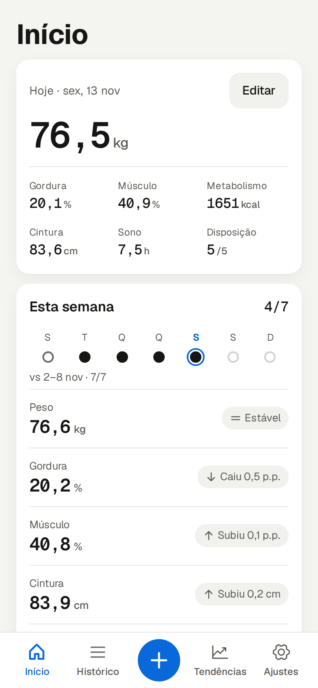
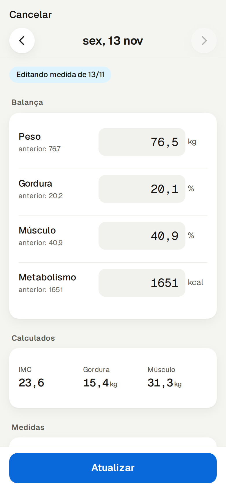
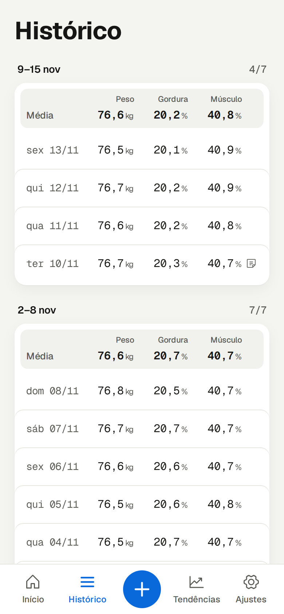
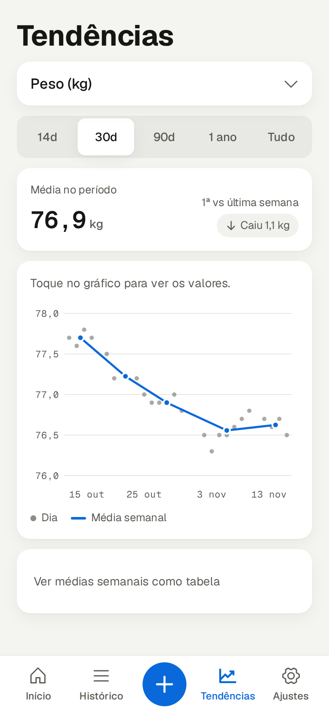

<p align="center">
  
</p>

<h1 align="center">BodyLog</h1>

<p align="center">A personal, mobile-first PWA for logging daily body metrics from a bioimpedance scale and tracking weekly progress through simple averages and comparisons.</p>

BodyLog replaces a spreadsheet: log the morning's scale readings in a few taps on the phone, then see how this week compares with the last one without calculating anything. It is built for one person, on purpose, and is not a generic fitness platform.

| Início                                   | Registro                                         | Histórico                                      | Tendências                                       |
| ---------------------------------------- | ------------------------------------------------ | ---------------------------------------------- | ------------------------------------------------ |
|  |  |  |  |

## Features

- One measurement per date per account: weight is the only required field; body fat %, muscle %, resting metabolism, waist, sleep, disposition and notes are optional. Picking a date with a record opens it for editing.
- BMI, body fat kg and muscle kg derived from each reading.
- The partial current week compared with the previous full week (Monday to Sunday), with neutral up/down/stable variations and percentage metrics in percentage points; no health advice or judgment.
- History grouped by week, one trend chart at a time, light and dark themes.
- CSV import from the old spreadsheet and CSV export for backup.
- Installable PWA with GitHub sign-in and a private history per account, served by one Cloudflare Worker with D1.

## Quickstart

```sh
git clone https://github.com/antonbsa/bodylog.git
cd bodylog
nvm use
npm install
npm run db:setup:local
npm run dev
```

Open `http://localhost:5173` and tap **Entrar como dev** to sign in as the local seed user. The [run locally guide](docs/guides/run-locally.md) covers seeding, tests and the other scripts.

## Documentation

- [Product](docs/product.md): what it is for, the core flows, the requirements and what it deliberately doesn't do
- [Architecture](docs/architecture/overview.md): how it works end to end and why
- [All documentation](docs/README.md): guides, operations, reference, decisions and history

Executable work is tracked as GitHub issues; conventions for coding agents live in [`AGENTS.md`](AGENTS.md).

## License

[MIT](LICENSE)
