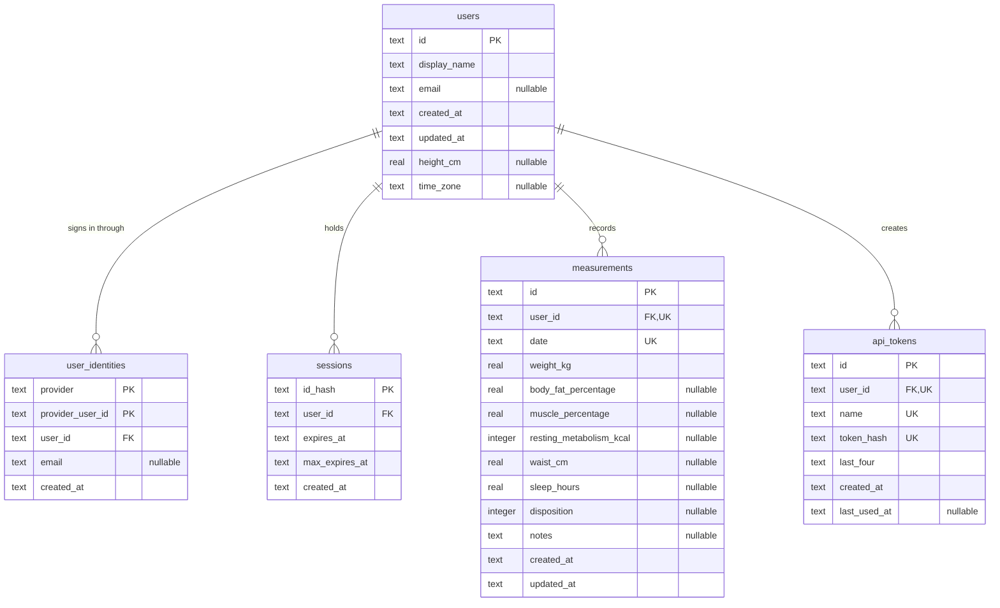

# Database

The D1 (SQLite) schema: what each table holds, how the tables relate, which unique keys the write rules depend on, and the lifecycle of each status column. What a measurement means (fields, limits, derived values, weekly rules, CSV) is in [Measurements](measurements.md); why SQL stays behind repositories is in the [architecture overview](../architecture/overview.md#database). The [diagram](#diagram) lists every column with its type, checked against the migrations by `tests/api/database-doc.test.ts`; defaults and indexes live only in the migrations (`infra/migrations/`), the schema's source of truth.

## Conventions

- **Ids** are random UUIDs in text columns (`crypto.randomUUID()` in the repositories). `user_identities` is keyed by the provider's own account id instead, and `sessions` by a hash of the cookie's id. `api_tokens` has a UUID id and stores a hash of the token, like `sessions`.
- **Timestamps** are ISO 8601 UTC strings in `*_at` text columns, so comparing them as text compares them in time; dates (`measurements.date`) are `YYYY-MM-DD`.
- **Every row belongs to a user.** Each table references `users(id)` with `ON DELETE CASCADE`, so deleting a user deletes their identities, sessions, measurements and API tokens ([ADR 0044](../decisions/0044-multi-user-accounts-with-oauth-sign-in.md)). Every measurement and API token query filters by `user_id`.
- **Rows are hard-deleted.** No table has a soft-delete column: a deleted measurement, an ended or expired session and a revoked API token are removed.
- **Enumerations are checked in TypeScript, not by the database.** `user_identities.provider` is plain text with no `CHECK` constraint; its values are listed under [Lifecycles](#lifecycles).

## Diagram

The diagram lists every column, with its SQL type and `nullable` when it accepts null; `tests/api/database-doc.test.ts` fails when it and the migrated schema disagree.

`UK` marks a column that is part of a unique key; the keys, including composite ones, are listed under [Unique Keys](#unique-keys).

## Tables

| Table             | One row per                     | Holds                                                                                                                                                                                                                                                                                                                                                                                               |
| ----------------- | ------------------------------- | --------------------------------------------------------------------------------------------------------------------------------------------------------------------------------------------------------------------------------------------------------------------------------------------------------------------------------------------------------------------------------------------------- |
| `users`           | account                         | The display name and the email (nullable), refreshed from the provider on every sign-in; the email changes only to one the provider verified. The height in cm (null until set in Ajustes, BMI is null meanwhile) and the IANA time zone the device last reported (null until the first sync, read as `America/Sao_Paulo`) ([ADR 0046](../decisions/0046-per-user-height-and-device-time-zone.md)). |
| `user_identities` | provider account that signed in | Which user a provider account maps to, with the email the provider verified (else null). A new identity joins the user of an existing identity with the same email. A user can have one identity per provider.                                                                                                                                                                                      |
| `sessions`        | signed-in browser               | The SHA-256 (hex) of the cookie's random id, never the id itself, plus the expiry and the hard limit on renewal ([auth](../architecture/overview.md#authentication)).                                                                                                                                                                                                                               |
| `measurements`    | user and date                   | One day's body metrics: weight plus the optional metrics and notes described in [Measurements](measurements.md#fields).                                                                                                                                                                                                                                                                             |
| `api_tokens`      | personal API token              | The user's name for the token, the SHA-256 (hex) of the token and its last four characters, never the token itself, and when it was created and last used.                                                                                                                                                                                                                                          |

## Unique Keys

The write rules lean on these keys: a write that would duplicate one updates the existing row instead, so saving a date again or re-importing a CSV changes values rather than adding rows.

| Table             | Unique key                                 | Guarantees                                                                                              |
| ----------------- | ------------------------------------------ | ------------------------------------------------------------------------------------------------------- |
| `user_identities` | `provider, provider_user_id` (primary key) | A provider account maps to one user; signing in again finds it and refreshes the profile.               |
| `measurements`    | `user_id, date`                            | One measurement per date per user; saving a date that has one edits it, and CSV import upserts by date. |
| `api_tokens`      | `user_id, name`                            | A user's token names are unique; creating a token with a name the user already has is rejected.         |
| `api_tokens`      | `token_hash`                               | A token resolves to exactly one row, and so to one user.                                                |

## Lifecycles

| Column                     | Values                    | Transitions                                                                                                                                                                                                                                                                                                                                    |
| -------------------------- | ------------------------- | ---------------------------------------------------------------------------------------------------------------------------------------------------------------------------------------------------------------------------------------------------------------------------------------------------------------------------------------------- |
| `user_identities.provider` | `github`, `google`, `dev` | Set once on first sign-in. `dev` is the local passwordless user, signed in only where `DEV_LOGIN_ENABLED` is `true`.                                                                                                                                                                                                                           |
| `sessions.expires_at`      | a timestamp               | Sign-in sets it 30 days out. A request in the session's last 7 days moves it to 30 days from now, never past `max_expires_at` (180 days after sign-in). A request that arrives after it deletes the row, and every sign-in sweeps expired rows, so no cron is needed. Signing out, or signing in again from the same browser, deletes the row. |

## Changing the Schema

Add a new migration file in `infra/migrations/` (never edit an applied one) and update the repository in `apps/api/src/db/repositories/` ([infra AGENTS.md](../../infra/AGENTS.md)). Update this page in the same change when a table, a relation, a unique key or an enumeration value changes, and [Measurements](measurements.md) when a measurement field or rule changes.
